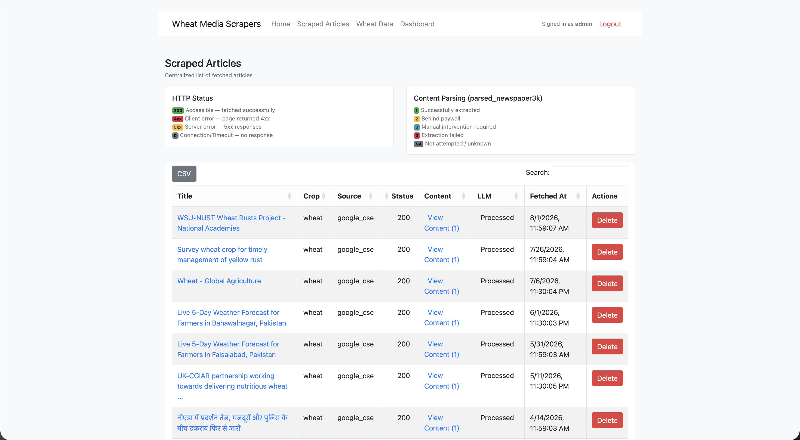
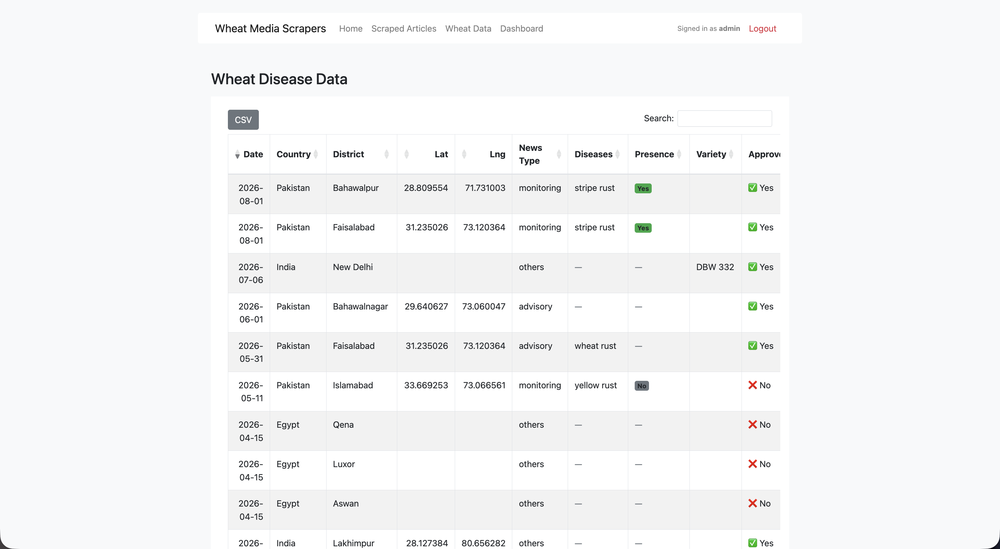
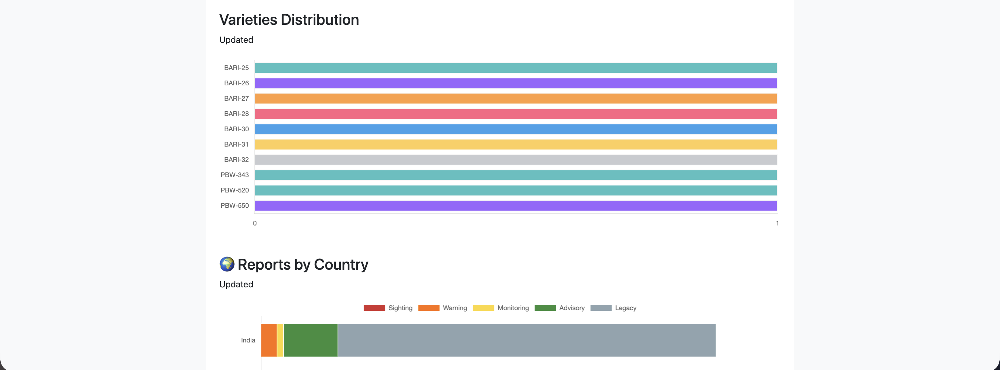
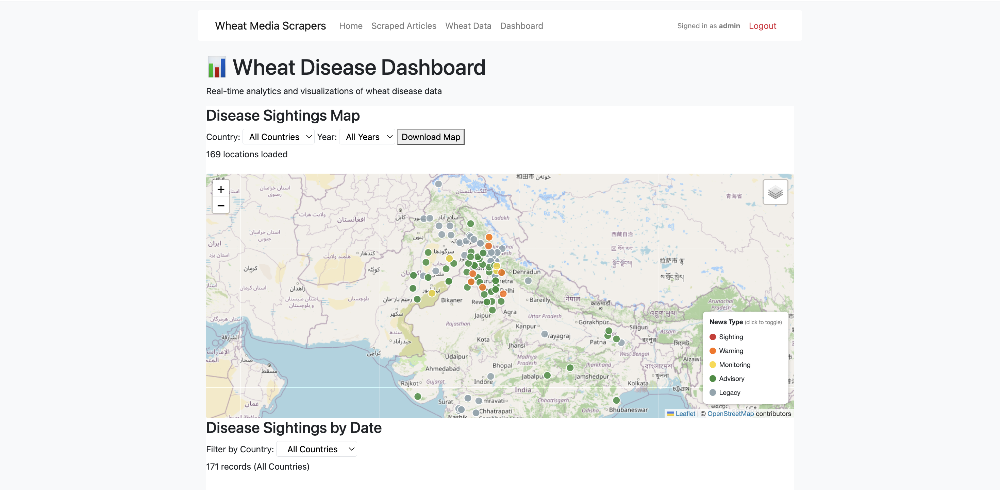

# Media Scraper

An automated system for collecting and analyzing news articles about wheat rust disease and related agricultural concerns from across South Asia. This project demonstrates end-to-end data engineering practices: automated collection, intelligent processing via LLM, validation against ground truth, and geographic intelligence extraction.

## System Architecture

```
News Sources       Content Extraction       LLM Processing       Storage & Access
     ↓                    ↓                      ↓                    ↓
┌──────────────┐  ┌──────────────────┐  ┌──────────────────┐  ┌──────────────┐
│ Google       │  │ URL Validation   │  │  Groq API        │  │  SQLite DB   │
│ Custom Search│→ │ newspaper3k      │→ │  Structured      │→ │  REST API    │
│ API          │  │ HTTP validation  │  │  Extraction      │  │  Dashboard   │
└──────────────┘  └──────────────────┘  └──────────────────┘  └──────────────┘
```

## Overview

This application automatically collects, processes, and analyzes news articles about wheat rust disease using AI-powered feature extraction. The system employs a multi-stage pipeline with semantic validation, geographic reasoning, and structured data extraction—demonstrating how LLMs can enhance traditional data engineering workflows.

## Key Capabilities


*Data Collection & Staging: Google Custom Search API aggregation and initial processing pipeline*

### Core Pipeline
- **Data Collection**: Google Custom Search API with APScheduler automation
- **Content Extraction**: URL validation and article text parsing via newspaper3k
- **LLM Processing**: Groq API reads all extracted articles for semantic relevance classification
- **Structured Output**: Geographic location, disease classification, wheat variety identification


*Extracted Data: Structured information extracted by LLM including location, disease type, variety, and confidence scores*

## Features

- **Automated Collection** – Continuous background scraping via APScheduler
- **LLM-Powered Analysis** – Groq API for intelligent data extraction and classification
- **REST API** – Programmatic access with filtering and authentication
- **Interactive Dashboards** – Real-time visualizations with Highcharts and DataTables
- **Scalable Design** – Docker-based deployment with SQLite backend
- **Data Quality** – Duplicate detection, validation, and confidence scoring

### Dashboard Visualizations


*Analytics Dashboard: Real-time charts and statistics with Highcharts for trend analysis*


*Regional Intelligence: Interactive geographic mapping using Leaflet.js showing wheat rust disease outbreak distribution across South Asia*

## Production Results

**Pipeline Performance (10+ months in production)**
- 2,744 URLs collected across 303 days
- 1,977 live URLs validated (767 dead links filtered at zero cost)
- 1,364 articles successfully extracted (613 failed: 251 paywalls, 227 manual intervention, 135 extraction errors)
- 36 classified as relevant (LLM read all 1,364 and identified genuine disease reports)
- 1,105 rejected as off-topic despite keyword matches (LLM semantic filtering vs. keyword-only approach)
- 221 permanent failures; 2 still in pipeline

**Geographic Coverage (of the 36 classified reports)**
- India: 29 (82%)
- Pakistan: 4 (11%)
- Bangladesh: 1 (3%)
- Egypt: 1 (3% — geo-leak)
- Australia: 1 (3% — geo-leak)

Note: Two records fall outside South Asian scope. This is upstream in the search layer; a simple country allowlist would eliminate this leakage.

**Seasonality – Live URLs Validated by Month**

| Month   | URLs |
|---------|------|
| 2025-09 | 1    |
| 2025-12 | 4    |
| 2026-01 | 17   |
| 2026-02 | 311  |
| 2026-03 | 359  |
| 2026-04 | 394  |
| 2026-05 | 427  |
| 2026-06 | 317  |
| 2026-07 | 147  |

Collection volume tracks the wheat disease calendar: minimal coverage off-season (Sep, Dec, Jan), then sharp rise Feb–May as rust develops on maturing crops and advisories accumulate through the growing cycle, declining post-harvest. The pipeline captures disease-relevant news timing, not just sowing cycles.

## Comparison Analysis: LLM Geographic Extraction Validation

To validate the LLM's geographic reasoning capability, extracted district coordinates were compared against manually curated ground-truth data. This test measured whether the LLM could reliably infer and verify geographic locations from unstructured news text.

**Coordinate Matching Results**

| Metric | Value |
|--------|-------|
| Total district-level extractions tested | 56 |
| Exact coordinate matches | 54 |
| **Overall accuracy** | **96.4%** |

**Precision by Distance Threshold**

| Distance Threshold | Matches | Accuracy |
|--------------------|---------|----------|
| Within 100m | 43 | 76.8% |
| Within 1km | 54 | 96.4% |
| Within 10km | 54 | 96.4% |

**Distance Distribution**

- **Median error**: 0.03 km (30 meters)
- **Mean error**: 13.88 km  
- **Min error**: 10 meters
- **Max error**: 737 km (2 outlier cases with incorrect district inference)

**Key Findings:**
- The LLM achieves 96.4% accuracy in matching district-level coordinates from unstructured news text
- 76.8% of extractions place the event within 100 meters of ground truth, indicating precise geographic reasoning
- The high median (30m) vs. mean (13.88km) shows the distribution is right-skewed by 2 misclassified districts
- Results demonstrate that LLM-based geographic extraction is reliable for filtering false positives and validating newsworthy disease events

## Quick Links

- 🌐 **Live Application**: https://mediascraper.saralcodes.xyz/
- 📖 **Full Documentation**: See technical documentation on the live site
